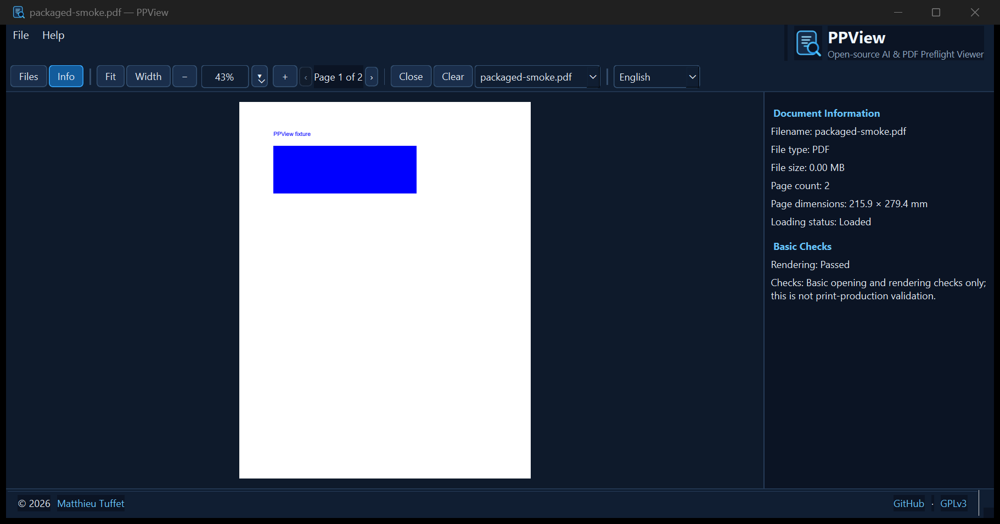

# PPView — Documentation française

PPView 0.1.3 est une application Windows légère qui prévisualise localement les fichiers PDF et Adobe Illustrator contenant du contenu PDF compatible. Elle rend les vraies pages avec PDFium et ne modifie jamais les documents source.

Les fichiers PDF et `.ai` compatibles PDF peuvent être ouverts par glisser-déposer, avec **Fichier > Ouvrir des fichiers** (`Ctrl+O`) ou depuis l’explorateur intégré. Les fichiers AI sans représentation PDF accessible ne peuvent pas être prévisualisés. Le rendu PDF peut différer du document Illustrator modifiable. Un affichage réussi ne garantit pas la conformité à l’impression.

L’interface est disponible en anglais, japonais et français. La langue se change dans la barre d’outils et le choix est mémorisé. Le thème bleu nuit et bleu comprend un navigateur de fichiers masqué initialement, des commandes Fit Page/Fit Width, zoom réglable, navigation multipage et panneaux d’informations/contrôles de base.

## Capture d’écran



Capture réelle de l’application portable Windows.

## Exécuter depuis les sources

Environnement de build Windows reproductible : CPython 3.11.5 64 bits et dépendances verrouillées dans `requirements-lock.txt`.

```powershell
py -3.11 -m venv .venv
.\.venv\Scripts\Activate.ps1
python -m pip install -r requirements-lock.txt
python -m pip install --no-deps -e .
python -m ppview.main
python -m pytest
```

## Créer l’application Windows

```powershell
./scripts/build_windows.ps1
```

Le script crée le dossier portable `dist/PPView/` et l’archive `dist/PPView-windows-x64.zip`. PyInstaller inclut les dépendances Qt/PDFium et l’icône SVG. Les notices de licence sont incluses. Les tests GitHub Actions construisent également l’archive sur Windows.

PPView est sous licence GNU GPLv3. Consultez [LICENSE](LICENSE), [THIRD_PARTY_LICENSES.md](THIRD_PARTY_LICENSES.md) et [LICENSES/LGPL-3.0.txt](LICENSES/LGPL-3.0.txt).
