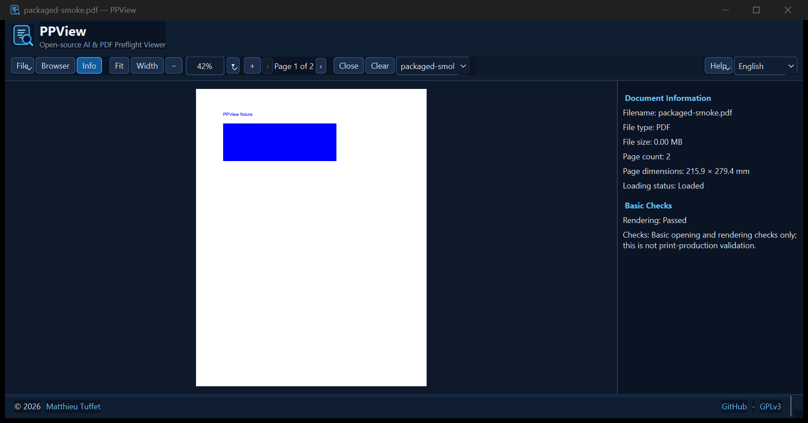

# PPView

PPView 0.1.4 は、印刷会社へ入稿する前に PDF および PDF 互換コンテンツを含む Adobe Illustrator ファイルを確認するための、軽量なローカルデスクトップアプリです。PDFium を使用して PDF ページの実データを描画し、画像、文字、イラストの欠落や配置を目視確認できます。PDF や Illustrator の編集ソフト、専門的なプリフライトソフトではありません。


インターフェースの [フランス語](assets/screenshots/PPView-v0.1.4-fr.png) と [日本語](assets/screenshots/PPView-v0.1.4-ja.png) のキャプチャもあります。

**元ファイルを変更することはありません。** 処理はすべてローカルで行い、アカウント、テレメトリー、クラウド処理、アップロード機能はありません。

## 対応形式と制限

- PDF ドキュメント（拡張子だけでなく内容を検査して読み込みます）。
- PDF 互換コンテンツを含む Adobe Illustrator `.ai` ファイル。サムネイルではなく PDFium でページを描画します。
- PDF 互換コンテンツがない AI ファイルはプレビューできません。独自 Illustrator 形式の完全な解析には対応しません。
- AI ファイル内の PDF 表現は編集可能な Illustrator ドキュメントと異なる場合があります。PDF のページ数とアートボード数は一致するとは限りません。
- 正常に開いて描画できても印刷品質を保証しません。v0.1 はファイルアクセス、ページサイズ、描画の基本確認を行います。高度なプリフライトは v0.2 以降の予定です。

## 使い方

複数ファイルをウィンドウのどこにでもドラッグ＆ドロップするか、**ファイル > ファイルを開く** / **Ctrl+O** で複数選択します。追加したファイルは一覧に入り、最後に追加したファイルを表示します。同じ正規パスの重複は追加されません。**ファイル > フォルダーを開く**、または初期状態で非表示の「ファイルブラウザー」サイドバーからローカルドライブとフォルダーを参照できます。複数ファイルを選択して「選択したファイルを開く」を押せます。ドライブ一覧は最初は折りたたまれ、必要な範囲を遅延読み込みします。最後に参照したフォルダーとサイドバー幅を保存します。ツールバーの一覧でドキュメントを切り替え、「ドキュメントを閉じる」または「すべて閉じる」を使えます。ページを開くと「ページ全体」に合わせます。左または中央ボタンを押しながらドラッグして移動し、プレビュー上のホイールでポインター位置を中心に拡大縮小し、Ctrl+ホイールも使用できます。プレビューをダブルクリックするとページ全体に戻ります。倍率は直接入力、スライダー、または倍率コントロール上のホイールで変更できます。情報パネルはドキュメント情報と基本描画チェックを分けて表示します。印刷適合性の保証ではありません。ツールバーで英語、日本語、フランス語を選ぶと設定が保存されます。対応言語では初回に Windows の言語を使用します。初回は Windows の言語を使用します。ウィンドウ下部のフッターに作者サイト、GitHub、GPLv3 へのリンクがあります。

起動時に `PPView.exe` へファイルパスを渡すこともできます。

## ソースから実行・テスト

Python 3.10 以降が必要です。再現可能な Windows ビルド環境は 64-bit CPython 3.11.5 で、`requirements-lock.txt` に固定した依存パッケージを使用します（PySide6 6.11.0、pypdfium2/PDFium 5.14.0、pytest 8.4.2、PyInstaller 6.22.3）。

```powershell
py -3.11 -m venv .venv
.\.venv\Scripts\Activate.ps1
python -m pip install -e .[dev]
python -m ppview.main
python -m pytest
```

## Windows 版のビルド

Windows と Python 3.11 が必要です。

```powershell
./scripts/build_windows.ps1
```

スクリプトはプロジェクトの `.venv` を再作成し、固定依存をインストール後に pytest と PDFium の読み込み・描画・解放チェックを実行してビルドします。続いて配布版を生成 PDF で起動し、実際の描画と Qt / PDFium DLL の同梱を確認します。`dist/PPView/` にフォルダー配布版、`dist/PPView-windows-x64.zip` に ZIP が作成されます。GitHub Actions は `main` への push、プルリクエスト、手動実行でテストと Windows x64 ビルドを行い、ワークフロー成果物として ZIP を公開します。配布物には GPL とサードパーティのライセンス表記を含みます。

## ライセンス

PPView は GNU GPLv3 です（[LICENSE](LICENSE)）。PySide6、pypdfium2/PDFium、pytest、PyInstaller を使用します。依存ライセンスの詳細は [THIRD_PARTY_LICENSES.md](THIRD_PARTY_LICENSES.md) と [LGPLv3 の全文](LICENSES/LGPL-3.0.txt) を参照してください。


## 言語と外観

PPView は英語、日本語、フランス語に対応します。ツールバーから再起動せずに切り替えられます。濃紺と青を基調とする高コントラストのテーマと、PPView オリジナルの SVG アイコンを採用しています。


英語の説明は [README.md](README.md)、フランス語は [README.fr.md](README.fr.md) を参照してください。
